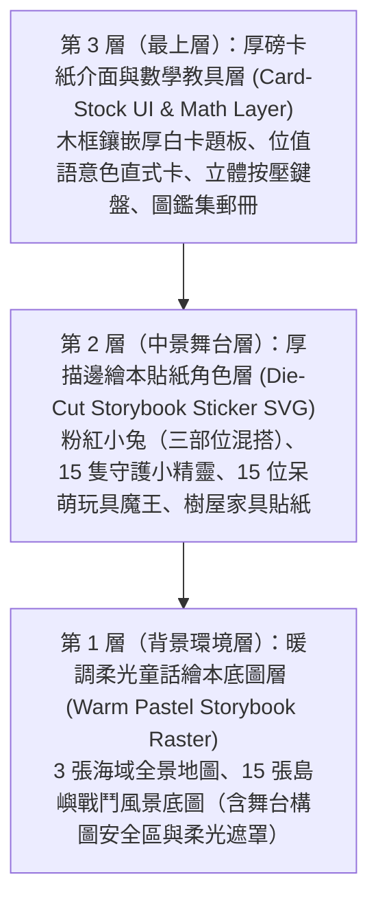

# 數學冒險島 — 美術風格指導規範（Art Style Guide）

- **適用範圍**：數學冒險島（全站第 5 主分頁，含三大海域地圖、戰鬥舞台、4 種積木小幫手、秘密樹屋、雙軌圖鑑、星星幣商店與無盡試煉塔）
- **目標受眾**：國小二年級學童（7～8 歲），支援電腦（桌機／筆電）與平板（橫向／直向）觸控操作（依 [ADR-0004](adr/0004-desktop-and-tablet-viewport-scope.md)）
- **相關領域文件**：
  - [領域詞彙表](../GLOSSARY.md)
  - [ADR-0005：數學冒險島採用「立體繪本紙劇場」介面與「厚描邊繪本貼紙」向量美術方向](adr/0005-popup-storybook-theater-and-sticker-svg-art-direction.md)
  - [數學冒險島擴展規格書](../.scratch/math-adventure-island/spec.md)

---

## 1. 核心視覺定位：立體繪本紙劇場（Pop-up Storybook Theater）

「數字積木屋」全站四大教學教室採用 **Hum 手作剪紙與厚磅卡紙（Card-Stock & Papercut）** 設計系統（見 [css/tokens.css](../css/tokens.css)）。為確保孩子從「教學教室」走進「數學冒險島」時擁有連貫的品牌體驗，同時感受到闖關世界的奇幻魅力，數學冒險島的視覺總定位為：

> **「從厚磅卡紙數學課本中翻開的立體繪本紙劇場（Pop-up Storybook Theater）」**

### 三大媒材分層架構
整個冒險島畫面由下而上固定由三個材質層疊合而成，彼此職責分明、互不搶戲：



---

## 2. 色彩系統與「位值語意色絕對優先」法則

### 2.1 最高紅線：位值語意色絕對優先（Semantic Color Immunity）
凡是涉及**數學位值、算式結構與十進位積木表徵**的視覺元件（包含：迷你直式加減對齊卡、加減十進位積木小幫手、位值組數卡、兩步驟線段對照圖、九九乘法被乘數／乘數標籤），**必須 100% 鎖定使用全站課本位值語意色（定義於 [css/tokens.css](../css/tokens.css#L131-L155)）**：

| 位值／數學語意 | 對應教具表徵 | 主色 Token | 淺底 Token | 邊框 Token | 深字 Token | 視覺禁用紅線 |
| --- | --- | --- | --- | --- | --- | --- |
| **千位（Thousands）** | 紫色千位立方體 | `--th-color` | `--th-soft` | `--th-border` | `--th-color-dark` | 嚴禁因海域或關卡主題而改色 |
| **百位（Hundreds）** | 水藍百格板／被乘數 $a$ | `--h-color` | `--h-soft` | `--h-border` | `--h-color-dark` | 嚴禁在糖果鎮或天空城改為粉紅或金色 |
| **十位（Tens）** | 暖橘十格棒／乘數 $b$ | `--t-color` | `--t-soft` | `--t-border` | `--t-color-dark` | 嚴禁與警告紅或一般裝飾黃混淆 |
| **個位（Ones）** | 石板白／灰小方塊 | `--o-color` | `--o-soft` | `--o-border` | `--o-color-dark` | 保持高對比清晰邊框，不可融入白底消失 |

### 2.2 四大劇場主題色票（Realm Theater Palettes）
在遵守「題卡內芯恆為暖白厚卡紙（`--color-card`）」的前提下，**舞台外框、頂部 HUD 橫樑、海域切換籤與木牌頂飾**依當前場域套用以下四組劇場主題色票：

| 場域 ID | 場域名稱 | 主題氛圍 | 舞台主框／頂飾色 | 舞台柔光底襯色 | 徽章／焦點強調色 |
| --- | --- | --- | --- | --- | --- |
| `sunny` | ☀️ **陽光加減群島** | 晨間暖陽琥珀調 | `#d97706` / `oklch(66% 0.16 68)` | `#fef3c7` / `oklch(95% 0.06 90)` | `#f97316`（蜜桃暖橘） |
| `mul` | 🌲 **九九乘法奇幻群島** | 森林午後翠綠調 | `#15803d` / `oklch(53% 0.14 148)` | `#dcfce7` / `oklch(95% 0.05 148)` | `#b45309`（木質暖棕） |
| `cloud` | ☁️ **雲端應用王國** | 浮空黎明天青調 | `#0284c7` / `oklch(58% 0.15 242)` | `#e0f2fe` / `oklch(95% 0.04 235)` | `#7c3aed`（星光薰衣草紫） |
| `tower` | 🗼 **無盡試煉塔** | 星穹試煉紫金調 | `#5b21b6` / `oklch(45% 0.18 292)` | `#ede9fe` / `oklch(94% 0.04 292)` | `#eab308`（榮耀皇冠金） |

> [!IMPORTANT]
> **禁止死黑與刺眼霓虹**：即使是「無盡試煉塔」或最終魔王關卡，背景與邊框也必須保持繪本暖調（星夜紫與琥珀金），嚴禁使用純黑（`#000000`）底色或高飽和刺眼螢光綠／螢光紫。

---

## 3. 字型、排版與低年級閱讀友善規範（Typography & Readability）

### 3.1 字型家族統一（淘汰 `ZCOOL KuaiLe`）
- **全面停用 `ZCOOL KuaiLe`**：該裝飾字型筆畫粗細不均且轉折沾黏，對剛建立國字字形概念的國小二年級學童會造成閱讀阻礙。
- **標題、木牌、HUD 與按鈕（`--font-display`）**：
  ```css
  font-family: "Chillax", "Zen Maru Gothic", "Noto Sans TC", ui-rounded, ui-sans-serif, sans-serif;
  font-weight: 700;
  ```
- **算式、迷你直式、計數器與數字鍵盤（`--font-num`）**：
  - 使用同一圓潤無襯線字族，並**強制設定 `font-variant-numeric: tabular-nums`**（等寬數字對齊），確保直式百、十、個位與進退位欄位在垂直方向毫秒不差地對齊。

### 3.2 生活應用題題幹排版與「關鍵字高光膠囊」
1. **字級與行寬**：
   - 生活應用題題幹（`.mqst-story-text`）字級不得小於 `clamp(1.125rem, 2.2vw, 1.35rem)`（最小 `18px`）。
   - 行高固定為 `1.6`～`1.65`，單行最大寬度控制在 `36～40` 個中文字（約 `38em`）以內，防止孩子換行時跳行漏讀。
2. **關鍵數量與單位高光膠囊（Highlight Pill）**：
   - 題幹中的核心數學條件（如 `每盒 8 元`、`買了 4 盒`、`付了 100 元`、`比熊熊多 18 顆`）必須使用厚卡紙膠囊標籤包覆（暖黃底 `--color-accent-soft`、深褐字 `--color-ink`、圓角 `8px`、底邊 `2px` 厚卡邊），協助學童從長句中快速提取運算條件。
3. **語音朗讀按鈕並置**：
   - 每道生活應用題題幹旁必須常駐大尺寸（`>= 44×44px`）「🔊 聽題目」圓形厚卡紙按鈕，支援點按即讀。

---

## 4. 場景底圖規範：暖調柔光童話繪本插畫（Raster Backgrounds）

適用於 `public/assets/quest/world-map*.jpg`（3 張世界地圖）與 `public/assets/quest/bg-*.jpg`（15 張島嶼戰鬥舞台背景）：

### 4.1 筆觸與色調標準
- **媒材風格**：暖調柔光水彩／色鉛筆童話繪本插畫（Warm Pastel Storybook Illustration）。
- **光影與彩度**：柔和漫射光（Soft Diffused Lighting），陰影處帶環境色溫（暖棕、紫灰或深藍綠），不出現純黑死影；整體明度偏高、彩度溫和，不搶奪前景貼紙角色的視覺焦點。
- **禁止風格**：寫實 3D 渲染、像素風（Pixel Art）、高對比美式漫畫網點、AI 塑膠金屬反光感。

### 4.2 戰鬥背景「舞台構圖安全區（Stage Safe Zones）」
所有 `16:9` 戰鬥舞台背景圖必須遵守三段式景深構圖：
1. **遠景（畫面上半部 0%～35%）**：放置具島嶼辨識度的主題地標（如奶油麵包村的風車烤爐、雲朵車站的蒸汽鐘樓、星光天空城的星象塔）。
2. **中景過渡區（畫面中央 30%～65%，算式木牌覆蓋區）**：色彩與紋理必須趨於平緩柔和，並由 CSS `.mqst-arena-scrim` 疊加輕量柔光漸層遮罩，確保中央「木框鑲嵌厚白卡」算式板邊緣清晰浮出。
3. **前景地面安全區（畫面下半部 55%～100%，角色站立對峙區）**：
   - 左右兩側（左側粉紅小兔＋守護小精靈站立區、右側關卡寶箱／島嶼魔王站立區）必須為**平坦開闊的地面／草地／雲毯／木棧道留白區**。
   - **嚴禁**在前景站立區繪製高對比碎花、雜亂石塊或強烈透視格線，以免干擾角色貼紙輪廓與腳底陰影。

---

## 5. 向量角色與道具規範：厚描邊繪本貼紙（Die-Cut Storybook Sticker SVG）

適用於 [src/quest/svg-art.js](../src/quest/svg-art.js) 與 [src/quest/treehouse-svg.js](../src/quest/treehouse-svg.js) 中的所有角色、魔王、小精靈、寶箱、魔法彈與樹屋家具：

### 5.1 統一輪廓墨線與貼紙紙影
1. **暖深褐圓角墨線**：
   - 所有主體外輪廓統一使用暖深褐墨色 **`#332b22`**（呼應繪本印刷墨線，嚴禁使用刺眼純黑 `#000000` 或無描邊色塊）。
   - 主輪廓線寬 `stroke-width: 2.8 ~ 3.2`，內部五官與細節線寬 `1.8 ~ 2.4`。
   - 強制設定 `stroke-linecap="round"` 與 `stroke-linejoin="round"`，消除任何尖銳夾角。
2. **雙層落地與貼紙陰影**：
   - **SVG 內部接地橢圓影**：角色腳底統一繪製半透明暖褐橢圓 `fill="rgba(51,43,34,0.14~0.16)"`，賦予站立在繪本地面上的重量感。
   - **CSS 外層貼紙投影**：角色容器套用 `--shadow-paper`，呈現如同厚卡紙剪紙貼在繪本上的立體層次。
3. **雙色溫和漸層填充**：
   - 角色身體主色塊採用垂直線性漸層（`x1="0" y1="0" x2="0" y2="1"`），頂部高光色與底部主色維持同色相、明度差約 `12%～18%`，並搭配兩頰粉紅腮紅橢圓（`#fb7185` / `#f472b6`, `opacity: 0.6~0.72`）。

### 5.2 座標契約與三部位換裝不遮臉紅線
| 角色類別 | 固定 `viewBox` | 比例與結構契約 |
| --- | --- | --- |
| **粉紅小兔（主角）** | `0 0 100 100` | 二頭身圓潤比例；五官位於 `y: 48~56`；圖層順序嚴格固定為：`接地影 → backLayer(披風/背包) → 兔耳/背包/手 → 身體 → bodyOutfitLayer(服裝) → handWandLayer(右手魔法杖) → 頭部 → headFrontLayer(頭飾) → 腮紅與五官 → faceOverlayLayer(眼鏡) → 雙腳`。 |
| **島嶼魔王／關卡寶箱** | `0 0 96 96` | 接地影位於 `cy="84~86"`；主體置中於 `x: 16~80, y: 18~80`；頂部皇冠或天線留出 `y: 7~18` 安全邊距。 |
| **守護小精靈** | `0 0 80 80` | 接地影位於 `cy="70~71"`；小巧圓潤的 1.5 頭身跟班比例；當親密度達 `Lv.3` 時於最底層注入 `.mqst-lv3-aura` 星光光環層（半徑 `r="29~34"`）。 |

> [!CAUTION]
> **頭飾不遮臉紅線（Hat Non-Occlusion Rule）**：粉紅小兔的所有 `hat` 頭飾圖層（`headFrontLayer`），下緣必須嚴格保持在 **`y <= 34`**（額頭上方），**絕對不可遮擋眼睛（`y = 48`）或臉頰**；唯有明確屬於臉部配件的款式（如 `glasses` 星星墨鏡）才可寫入 `faceOverlayLayer`。

### 5.3 呆萌玩具魔王原則（Toy & Dessert Boss Design）
- **去恐懼化造型**：所有 15 位島嶼魔王與守塔小魔王皆以**甜點（牛角麵包、千層蛋糕、糖霜機器人）、發條積木玩具、可愛海洋生物或擬人化建築（彩虹燈塔、蒸汽時鐘列車）**為原型。
- **統一情緒表情驅動**：所有角色與魔王共享 `buildFaceExpression(mood, lx, rx, y, mouthY, r)` 六種標準情緒：
  - `normal`（黑亮圓眼＋帶高光白點＋微笑弧線）
  - `happy`（彎月笑眼＋張口開心笑）
  - `fever`（閃亮四角星眼＋熱血笑容，連擊時觸發）
  - `oops`（`> <` 緊閉眼＋委屈波浪嘴＋藍色小汗滴，小兔答錯時觸發）
  - `hit`（`> <` 受擊眼＋驚訝圓嘴，魔王被擊中時觸發）
  - `dizzy`（同心圓蚊香眼＋波浪嘴，魔王被擊敗時觸發，趣味且零暴力感）

---

## 6. 介面元件與耐玩度收藏空間材質規範（UI & Retention Spaces）

### 6.1 戰鬥題卡：木框鑲嵌厚白卡（Wood-Framed Cardstock）
1. **外框與頂部木牌標籤**：
   - `.mqst-wood-board` 外框保留溫潤的繪本木質圓角邊框（或隨海域切換劇場主題色邊框），頂部懸掛膠囊形題型木牌（如 `🛒 購物找零`、`🍰 先乘後減`）。
2. **內芯高對比奶白厚卡紙**：
   - 承載故事題幹、算式與迷你直式的內部表面，**必須使用 `--color-card`（暖奶白厚卡紙）搭配 `--grain` 紙張紋理**，提供最高文字對比度與課本熟悉感。
3. **兩步驟分步引導（`guided_two_step`）視覺狀態機**：
   - **待命態（Step 2 未解鎖）**：淺灰虛線邊框（`1.5px dashed var(--color-rule-strong)`）、底色 `--color-paper-2`、透明度 `0.72`，明確傳達「先算完第 1 步再來算我」。
   - **聚焦作答態（當前步驟）**：亮藍實線厚邊框（`2.5px solid var(--color-focus)`）、外發光 `--shadow-focus`、底色純淨 `--color-card`。
   - **鎖定完成態（Step 1 已答對）**：薄荷綠柔和底色（`--good-bg`）、深綠邊框（`--good-border`）、左側顯示 `✅ 第 1 步完成` 徽章並鎖定算出之數值，同時以醒目向下箭頭將該數值串接至第 2 步算式。
4. **下半部立體厚卡紙鍵盤與選項卡**：
   - 所有數字鍵（`0`～`9`、退格、發射攻擊）與四選一卡片皆為實體厚卡紙按鈕：最小高度 `>= 52px`、圓角 `var(--radius-input)`、底部實體厚邊 `0 4px 0 0 var(--color-edge)`。
   - 按下瞬間（`:active`）產生真實物理下沉：`translate: 0 3px`，底邊縮減為 `1px`。
   - 「🚀 發射攻擊／確認」主按鈕固定採用高辨識度梨黃／琥珀金（`--color-accent` + `--color-accent-deep` 厚邊）。

### 6.2 🏡 秘密樹屋：剖面立體紙娃娃屋（Cross-Section Paper Dollhouse）
- **空間構圖**：採用正面剖面木屋舞台（`viewBox` 比例協調、支援桌面與平板橫直向），背景由「牆紙層（`wallpaper`）」與「木地板層」構成。
- **剪紙景深窗景（`window`）**：圓拱木窗內嵌剪紙風景（森林清晨、陽光海灣、雲端星海），作為房間的視覺呼吸窗。
- **貼紙家具與遊樂小精靈**：地毯（`rug`）、主家具（`furniture`）、角落擺飾（`decor`）與至多 3 隻遊樂位守護小精靈，全部遵循第 5 章「厚描邊繪本貼紙 SVG」繪製；點擊任何家具或精靈時觸發 `--ease-spring` 彈跳微動畫與暖白卡紙對話氣泡。

### 6.3 💎 雙軌圖鑑與故事收集冊：貼紙與浮雕集郵冊（Sticker & Embossed Album）
1. **81 格 9×9 乘法寶石牆**：
   - **未點亮格**：呈現「厚卡紙凹槽壓痕（Debossed Slot）」——內陰影 `inset 0 2px 3px rgba(51,43,34,0.12)`、暖灰底 `--color-paper-2` 與淡色乘法算式。
   - **已點亮格**：貼上飽和切面寶石貼紙，帶白色高光切角與立體卡紙底邊。
2. **24 張數學技能卡（銅／銀／金三階卡框材質）**：
   - **未解鎖（練習中）**：虛線卡紙框 ＋ 進度條（如 `1 / 3`）。
   - 🥉 **銅卡（3 題達成）**：暖赤陶銅色卡框（`#d97706` / `#fed7aa` 漸層底襯）＋ 1 顆銅星徽章。
   - 🥈 **銀卡（8 題達成）**：星光銀藍色卡框（`#0284c7` / `#e0f2fe` 漸層底襯）＋ 2 顆銀星徽章。
   - 🥇 **金卡（15 題達成）**：璀璨琥珀金雙層卡框（`#b45309` 外框 ＋ `#fef08a` 亮金底襯 ＋ 柔和斜角亮面高光條）＋ 3 顆金星皇冠徽章。
3. **💮 冒險印章本（手感橡皮郵戳卡）**：
   - 7 格印章卡採用暖奶油厚卡紙底板；未蓋章格為虛線圓形郵戳框（標註 `Day 1`～`Day 7` 與獎勵圖示）。
   - 已蓋章格呈現**帶隨機微傾角度（`-5deg ~ +5deg`）的實體橡皮印章壓紋**（朱紅或薄荷綠印泥質感＋小兔腳印／星星圖案），強化手作集章成就感。

---

## 7. 動態演出與教學優先邊界（Motion & Pedagogical Boundaries）

所有 GSAP 戰鬥動畫（[src/quest/battle-fx.js](../src/quest/battle-fx.js)）與 CSS 微互動必須嚴格遵守以下三條紅線：

1. **思考期零干擾（Quiet Thinking Phase）**：
   - 當題目呈現、等待學童思考與輸入時，舞台僅允許角色極輕微的柔和呼吸（垂直位移 `<= 3px`，週期 `>= 2.2s`）。
   - **嚴禁**在思考期播放背景閃爍、速度線、持續跳動的干擾粒子或任何倒數計時壓迫動畫。
   - 所有華麗戰鬥特效（魔法彈飛行、守護小精靈合體追擊、3 連擊／尾刀全螢幕必殺技 Cut-in）**僅能在玩家送出正確答案後的獎勵瞬間（`0.6s ~ 1.4s`）爆發**，且演出結束後必須立即清理圖層（`autoAlpha: 0, clearProps: 'transform'`）。
2. **答錯與開啟小幫手零懲罰感（Forgiving Feedback Motion）**：
   - 答錯瞬間，僅讓算式輸入框輕微水平搖晃（振幅 `<= 6px`，`0.25s`），小兔換上可愛的 `oops` 歪頭流汗表情，若裝備「守護護盾系」小精靈則浮現柔和薄荷藍護盾波紋。
   - 隨即以 `--ease-out` 平順滑出「積木小幫手」教學抽屜，將視覺焦點引導至十進位積木拆解、線段圖或跳數小火車。
   - **嚴禁**使用全螢幕紅光閃屏、裂痕特效或令人挫折的失敗大字報。
3. **無障礙減敏支援（`prefers-reduced-motion: reduce`）**：
   - 當系統偵測到 `prefers-reduced-motion: reduce` 時，`battle-fx.js` 與 CSS 必須自動停用常駐呼吸動畫、全螢幕必殺技閃光（`ultFlashVeil`）、速度線與鏡頭震動，改以靜態貼紙表情切換與溫和透明度淡入呈現。

---

## 8. 現有樣式收斂檢核表（`css/mul-quest.css` Alignment Checklist）

為落實 [ADR-0005](adr/0005-popup-storybook-theater-and-sticker-svg-art-direction.md)，在後續維護與擴展 [css/mul-quest.css](../css/mul-quest.css) 及 [index.html](../index.html) 時，須依序完成並遵守以下視覺收斂檢核項：

- [ ] **字型收斂**：移除 `css/mul-quest.css` 中所有 `"ZCOOL KuaiLe"` 字型宣告，將 `#mqst-arcade-overlay` 與各對話框（`#mqst-dex-dialog`、`#mqst-shop-dialog` 等）的標題與內文字型統一指向 `var(--font-display)` 與 `var(--font-body)`；所有算式、直式格、進度計數與鍵盤數字統一加上 `font-family: var(--font-num); font-variant-numeric: tabular-nums;`。
- [ ] **紙張材質與卡紙厚邊收斂**：將題卡內芯、對話框主體、商店商品卡與委託任務卡統一套用 `var(--color-card)` 背景與 `var(--grain), var(--fibre)` 紙張紋理；按鈕與選項卡統一採用厚卡紙立體底邊與 `:active` 物理下沉回饋。
- [ ] **四大劇場主題色票變數化**：以 `[data-realm="sunny" | "mul" | "cloud" | "tower"]` 或對應主題屬性驅動舞台外框、頂部 HUD 橫樑與木牌頂飾色彩，消除散落各處的硬編碼漸層色碼。
- [ ] **位值語意色零覆蓋檢查**：確認迷你直式卡（`.mqst-vcalc-*`）、位值組數卡與 4 種積木小幫手內部完全引用 `--th-*`、`--h-*`、`--t-*`、`--o-*` 語意變數，不受外層 `data-theme` 或 `data-realm` 影響。
- [ ] **電腦與平板視窗驗收**：在電腦（`1280×800`）與平板橫直向（`1024×768`、`768×1024`）實機驗證：生活應用題高光膠囊不擠壓折行、兩步驟引導上下算式框與下方數字鍵盤在同一畫面內不重疊、粉紅小兔所有頭飾皆滿足 `y <= 34` 不遮臉紅線。
